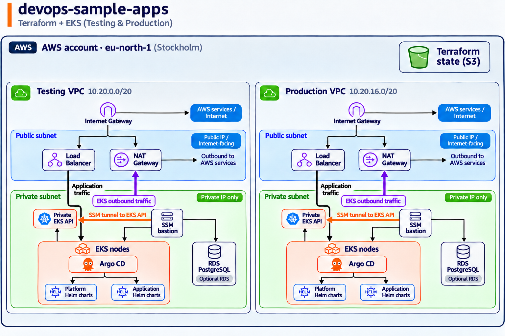

# devops-sample-apps

This repository uses a monorepo layout to make the exercise easier to review. In a real environment, the contents would be split across several repositories with separate ownership and release lifecycles:

- The Go application repository would contain the application code, build instructions, container build configuration, and image-publishing workflow.
- The PHP application repository would contain the equivalent PHP-specific code and build pipeline.
- A Terraform modules repository would contain reusable, non-application-specific infrastructure modules.
- A deployment repository would contain the Argo CD configuration and application deployment manifests.
- A Terraform live-configuration repository would instantiate the shared infrastructure and application-specific resources using the reusable modules.

## Repository structure

- `/apps` contains the Go and PHP application code, Docker build configuration, and application-specific build instructions.
- `/.github` contains the workflows that create application versions with `release-please` and build and publish the corresponding Docker images.
- `/terraform` contains the Terraform configuration:
  - `/terraform/bootstrap` contains the initial resources required before the rest of the infrastructure can be created, including the deployment user, its restricted policy, and the S3 bucket used for Terraform state.
  - `/terraform/core` instantiates shared, non-application infrastructure such as VPCs, subnets, NAT gateways, bastion hosts, EKS clusters, and Argo CD bootstrap resources.
  - `/terraform/apps` instantiates application-specific infrastructure. The Go and PHP applications do not currently require AWS resources, but this area contains the RDS configuration used by the exercise.
- `/deployment` contains the Argo CD manifests and ApplicationSets used to install the platform components and application Helm charts.

## How it works

The complete deployment procedure is documented in [`DEPLOY_INSTRUCTIONS.md`](DEPLOY_INSTRUCTIONS.md).

The deployment flow is:

1. Terraform creates the networking, bastion, EKS, and supporting AWS resources required for a functional cluster.
2. Terraform connects to the private Kubernetes API through the bastion using AWS Systems Manager (SSM) and bootstraps Argo CD.
3. Argo CD reads the manifests in `/deployment` and installs the platform components and application Helm charts into the cluster.

## Network address plan

Each environment has an independent VPC with a non-overlapping `/20` CIDR:

| Region | Environment | VPC CIDR |
| --- | --- | --- |
| `eu-north-1` | testing | `10.20.0.0/20` |
| `eu-north-1` | production | `10.20.16.0/20` |

Each `/20` provides 4,096 addresses. The current layout uses two public and two private subnets:

| Environment | Availability Zone | Public subnet | Private subnet |
| --- | --- | --- | --- |
| testing | `eu-north-1a` | `10.20.0.0/26` | `10.20.4.0/22` |
| testing | `eu-north-1b` | `10.20.0.64/26` | `10.20.8.0/22` |
| production | `eu-north-1a` | `10.20.16.0/26` | `10.20.20.0/22` |
| production | `eu-north-1b` | `10.20.16.64/26` | `10.20.24.0/22` |

The public `/26` subnets are intended for internet-facing load balancers and provide address headroom for additional load-balancer IPs. The private `/22` subnets provide capacity for EKS nodes, pods, the bastion, and other internal resources. They use the NAT gateway for outbound access and do not assign public IPs.

The subnet maps are keyed by Availability Zone. To add another AZ, add a non-overlapping public/private CIDR pair from the unused part of the `/20`; the VPC module creates the subnets and route associations, and EKS consumes the expanded private-subnet map. The unused ranges are deliberate and reserved for future AZs or growth.

## Releases

App changes with Conventional Commit messages open or update app-specific Release Please pull requests. Merging a release PR creates the GitHub release and publishes the image to GHCR with version, `master`, and commit SHA tags.

## Private access through the bastion and SSM

The bastion is a private EC2 instance with no public IP or inbound access. It has an instance profile with `AmazonSSMManagedInstanceCore` and reaches the AWS Systems Manager endpoints through the VPC NAT gateway.

Terraform uses the `dfns/tunnel` provider to open ephemeral SSM port-forwarding sessions through the bastion. The Kubernetes/Helm provider forwards TCP 443 to the private EKS API, while the PostgreSQL provider forwards TCP 5432 to the private RDS endpoint. The tunnels exist only during Terraform operations and are not stored in state.

The bastion security group allows the required outbound HTTPS traffic, and the EKS and RDS security groups allow connections from the bastion security group. This lets Terraform manage private cluster and database resources without exposing them to the operator's public IP.

## Approximate baseline cost

For continuous operation in `eu-north-1`, the current two-environment layout is roughly **$410–$490 per month before data transfer, logging, public IPv4, and variable backup/RDS usage**:

| Component | Approximate monthly cost |
| --- | ---: |
| Two EKS control planes | ~$146 |
| Five `t3.medium` worker nodes | ~$153 |
| Two `t3.micro` bastions | ~$15 |
| Two NAT gateways, excluding traffic processing | ~$66 |
| Optional testing RDS `db.t4g.small` and 20 GiB storage | ~$30–$40 |
| EBS and other baseline usage | Small additional amount |

## Improvements
The improvements below were intentionally left out of the exercise due to time constraints.

### Resources removal
The creation workflow has been worked out sufficiently to create the complete stack and its dependencies. A clean, fully automated removal still needs further refinement, especially around Terraform roots that manage dependent resources, PostgreSQL resources that require a live RDS connection, and partial failures during teardown.

### Security improvements

- GHCR images are public for this exercise. In a real environment, make the packages private and use scoped registry credentials such as an `imagePullSecret`.
- Use separate AWS accounts for testing, production, and management services such as Terraform state. Humans should use IAM Identity Center/SSO or assumed roles instead of long-lived access keys. Terraform should be run by automation such as Atlantis, deployed with an EC2 instance profile or another assumed role. EKS workloads can use IAM roles for service accounts (IRSA) or EKS Pod Identity.
- Workflows use GitHub-hosted runners for the exercise. A real environment should use hardened, organization-managed runners with controlled network access and sufficient capacity.
- The Go application intentionally remains unchanged and binds to port 80. Its non-root container therefore needs `NET_BIND_SERVICE`; in a real environment, make the port configurable and use an unprivileged port.
- Configure HTTPS at ALB level to expose the services, blocking http access. Configure a service mesh like istio to keep all comunications secure using mTLS
- RDS accessed by iam-db-auth to bootstrap users as soon as it's available in Terraform https://github.com/hashicorp/terraform-provider-aws/pull/50238

### Operational improvements

- Add linters, Terraform validation, security scanning, and application code-quality checks to CI.
- Argo could be spawned using EKS capabilities directly
- Pin Argo CD and other Helm charts by immutable commit or digest, not only a mutable chart version.
- Enable monitoring, centralized logging, and alerting.
- When extending the Terraform modules, keep resource keys statically known for `for_each`; use maps with stable keys when values depend on resources created during the same apply.
- Implement automated release promotion and progressive delivery using Argo CD with Kargo, or use Argo Workflows for workflow orchestration where needed.

## Application reliability note

The PHP image currently includes both repository configuration files and uses a wrapper to copy `config.prod` only when `APP_ENV=prod`; the testing environment is intentionally expected to fail. In a real environment, provide environment-specific configuration at runtime, or make the application select its configuration directly without a wrapper.
